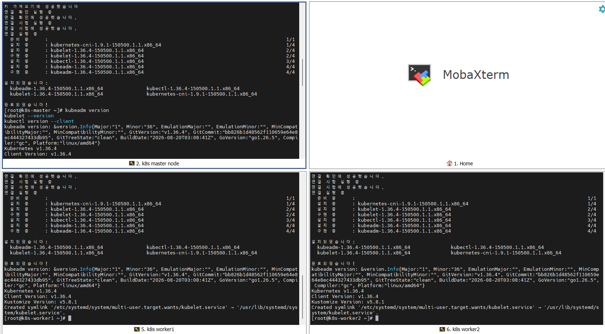
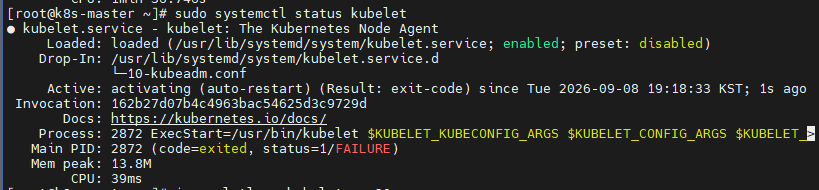

# 2026-09-08 — Day 05 (Phase 1)

## 오늘 목표
- kubeadm, kubelet, kubectl 설치 (버전 고정)
- runbook/cluster-bootstrap.md 초안 시작

## 오늘 한 일
- Kubernetes 지원 버전(1.35/1.36/1.37) 비교 후 v1.36 라인 선택
- pkgs.k8s.io stable/v1.36 저장소를 3대(master/worker1/worker2) 전부에 등록
- `dnf install kubelet kubeadm kubectl --disableexcludes=kubernetes`로 설치
- `kubeadm version` / `kubelet --version` / `kubectl version --client`로 3대 버전 통일 확인 (전부 v1.36.4)
- `systemctl enable --now kubelet` 실행 후 상태 확인
- `journalctl -u kubelet`로 crashloop 원인 로그 확인

## 왜 이 설정/방법을 선택했는가
| 항목 | 선택한 것 | 대안 | 선택 이유 |
|------|-----------|------|-----------|
| K8s 버전 | v1.36 (pkgs.k8s.io stable/v1.36) | v1.37(최신), v1.35(구버전) | 1.37은 릴리즈 2주밖에 안 돼 이슈 사례 부족, 1.35는 패치 지원 종료 임박 → 5개월차로 안정화된 1.36이 학습 용도에 적합 |
| repo exclude 설정 | repo 파일에 exclude 걸고, 설치 시에만 `--disableexcludes` 해제 | exclude 없이 설치 | 이후 `dnf update`로 의도치 않게 버전 스큐가 깨지는 사고 방지 |

## 오늘 처음 안 사실
| 몰랐던 것 | 알게 된 것 | 왜 그렇게 되는지 |
|-----------|-----------|----------------|
| kubelet만 설치하면 바로 정상 실행될 줄 알았음 | 설치 직후엔 **켜졌다 꺼지기를 반복(crashloop)하는 게 정상**. `systemctl status`에 `activating (auto-restart)`로 보임 | kubelet은 시작할 때 설정 파일을 읽는데, 그 파일은 패키지 설치가 아니라 `kubeadm init`/`join`이 만들어 줌. 파일이 없으니 에러(`exit 1`)로 종료되고, systemd가 자동으로 다시 켜서 반복됨. 로그: `failed to load kubelet config file ... config.yaml: no such file or directory` |

`kubeadm init`/`join`이 만드는 파일:

| 파일 | 역할 |
|---|---|
| `/var/lib/kubelet/config.yaml` | kubelet이 어떻게 동작할지 적은 설정 (cgroup 드라이버 등) |
| `/etc/kubernetes/kubelet.conf` | API 서버 주소와 인증 정보 (어디에 보고할지) |
| `kubeadm-flags.env` | kubelet 실행 시 붙는 추가 옵션 |

(Day 5 로그로 직접 확인한 건 `config.yaml` 하나. 나머지 둘은 `init`/`join`이 만든다는 지식으로 적음.)

## 검증 결과
```bash
# 3대 전부 동일
$ kubeadm version --output short   # v1.36.4
$ kubelet --version                # Kubernetes v1.36.4
$ kubectl version --client         # Client Version: v1.36.4

$ systemctl status kubelet
# Active: activating (auto-restart) (Result: exit-code)

$ journalctl -u kubelet -n 20 --no-pager
# E... "failed to load kubelet config file ... /var/lib/kubelet/config.yaml: no such file or directory"
```

## 결과·증거



## 복습 중 추가한 질문 (2026-11-09)

| 질문 | 요약 답변 |
|---|---|
| kubeadm, kubelet, kubectl이 각각 뭔가? | **kubeadm** = 클러스터를 만드는 설치 도구. `init`/`join`/`upgrade` 때만 실행하고 끝남. **kubelet** = 모든 노드에서 systemd 서비스로 상주하는 에이전트. API 서버에서 맡을 Pod를 받아 containerd로 띄우고, 노드·Pod 상태를 보고함(`get nodes`의 Ready/NotReady가 이 보고). 마스터의 apiserver/etcd/scheduler도 static pod로 kubelet이 띄우고 감시함. **kubectl** = 사람이 쓰는 클라이언트 CLI. API 서버(6443)에 요청을 보내며 접속 정보는 `~/.kube/config`에 있음 |
| repo의 `exclude` 설정이 뭔가? | `exclude=kubelet kubeadm kubectl cri-tools kubernetes-cni`를 걸면 `dnf update`/`install` 때 이 패키지들이 대상에서 빠짐. 설치·업그레이드할 때만 `--disableexcludes=kubernetes`(repo 파일 맨 위 `[kubernetes]` 이름)로 일시 해제. 평소 `dnf update`가 kubelet 등을 몰래 올려 노드 간·패키지 간 버전 스큐가 생기는 걸 막고, K8s 업그레이드는 `kubeadm upgrade`로 순서를 정해 직접 하기 위함 |

비유: kubeadm = 공사 업체(지을 때만 옴), kubelet = 건물마다 상주하는 관리인, kubectl = 관리사무소에 요청하는 창구.

→ Node, Pod, static pod 등 기본 개념은 [concepts/kubernetes-core.md](../concepts/kubernetes-core.md) 참고.

흐름:
```
[설치 시]  kubeadm init/join → 노드 설정 파일 생성 후 종료
[운영 중]  나 → kubectl → API 서버(6443) ← kubelet(각 노드) → containerd → 컨테이너
```

## 막힌 점
- 없음
