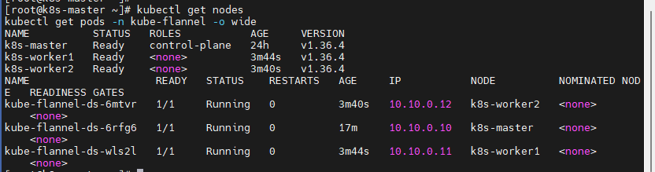

# 2026-09-10 — Day 07 (Phase 2)

## 오늘 목표
- Flannel(CNI) 설치로 마스터 Ready 전환
- 워커 2대 kubeadm join
- kubectl get nodes 전 노드 Ready 확인 + baseline evidence 캡처

## 오늘 한 일
- 마스터에 Flannel 설치 파일을 인터넷에서 받아 그대로 적용함. Day6에 정해둔 Pod IP 범위(10.244.0.0/16)와 Flannel의 기본 IP 범위가 같아서, 파일을 고칠 필요 없이 바로 설치됨
- Flannel Init 단계 거쳐 마스터 NotReady → Ready 전환 확인
- 워커 join용 토큰이 Day 6 발급분(24h TTL) 만료 임박(TTL 2m)한 것을 `kubeadm token list`로 확인 → `kubeadm token create --print-join-command`로 재발급
- 워커1, 워커2에서 각각 `kubeadm join` 실행 → 두 노드 모두 Ready 전환, flannel pod 3개(마스터+워커2) 전부 1/1 Running 확인

## 왜 이 설정/방법을 선택했는가
| 항목 | 선택한 것 | 대안 | 선택 이유 |
|------|-----------|------|-----------|
| join 순서 | 마스터 CNI 설치 → 워커 join | 워커 먼저 join 후 CNI 설치 | 마스터를 먼저 Ready로 만들어야 워커 join 시 정상적으로 붙는지 확인 가능 |
| join 토큰 | 재발급(`token create`) | 기존 Day6 토큰 재사용 시도 | TTL 24h 기본값 때문에 Day6 토큰이 거의 만료된 상태(TTL 2m)였음 |

## 오늘 처음 안 사실
| 몰랐던 것 | 알게 된 것 | 왜 그렇게 되는지 |
|-----------|-----------|----------------|
| kubectl apply -f (github URL)이 실제로 뭘 하는지 | GitHub는 YAML 설계도만 제공, 실제 flanneld 바이너리는 컨테이너 이미지(레지스트리)에서 pull됨 | DaemonSet 오브젝트가 만들어지면 K8s가 containerd에게 이미지 pull을 지시하는 구조이기 때문 |
| kubeadm join 토큰에 유효기간이 있다는 것 | 기본 TTL 24시간, 지나면 재발급 필요 | 토큰이 노출되면 누구나 클러스터에 노드를 끼워넣을 수 있어 보안상 임시값으로 설계됨 |

## 검증 결과
```bash
$ kubectl get nodes
NAME          STATUS   ROLES           AGE     VERSION
k8s-master    Ready    control-plane   24h     v1.36.4
k8s-worker1   Ready    <none>          3m44s   v1.36.4
k8s-worker2   Ready    <none>          3m40s   v1.36.4

$ kubectl get pods -n kube-flannel -o wide
NAME                    READY   STATUS    RESTARTS   AGE     IP           NODE          NOMINATED NODE   READINESS GATES
kube-flannel-ds-6mtvr   1/1     Running   0          3m40s   10.10.0.12   k8s-worker2   <none>           <none>
kube-flannel-ds-6rfg6   1/1     Running   0          17m     10.10.0.10   k8s-master    <none>           <none>
kube-flannel-ds-wls2l   1/1     Running   0          3m44s   10.10.0.11   k8s-worker1   <none>           <none>
```

## 결과·증거

Day 6에서 CNI 미설치로 NotReady였던 마스터가 Flannel 설치 후 Ready로 전환되고, 워커 2대 join까지 마쳐 3노드 전부 Ready + flannel pod 3개 전부 1/1 Running인 상태 — Phase 2 완료 시점의 baseline으로, 이후 Phase 5 장애 재현 시 "정상 상태" 비교 기준이 됨.

## 복습 중 추가한 질문 (2026-11-14)

| 질문 | 요약 답변 |
|---|---|
| Flannel이 뭔가? | Pod IP를 나눠주고 노드 간 Pod 통신 길을 만드는 CNI 플러그인 (아래 "Flannel 정리" 참고) |
| join의 의미는? | 워커를 클러스터에 등록하는 절차. 워커가 CA 해시로 마스터를 확인하고, 토큰으로 마스터가 워커를 확인한 뒤 인증서와 kubelet 설정 파일(Day 5에서 없던 것)이 생기고 Node 객체로 등록됨 |
| DaemonSet은 뭔가? Flannel에 왜 필요한가? | 노드마다 Pod를 하나씩 띄우는 방식. 네트워크 설정(자기 `/24` 대역, `flannel.1`, 경로)이 노드마다 따로 필요하므로 Flannel은 DaemonSet. 새 노드가 join하면 Pod도 자동으로 생김 |
| 마스터가 Ready가 된 이유는? | Flannel이 CNI 설정을 노드에 깔아 kubelet이 "네트워크 플러그인 준비됨"으로 보고했기 때문. Pod 대역이 Flannel 기본값과 같다는 건 YAML을 안 고쳐도 된 이유일 뿐 Ready의 이유가 아님 |
| 3노드 Ready인데 Pod 통신이 안 될 수 있는 이유는? | Ready는 kubelet 정상 + CNI 초기화까지만 보증. 이날 실제로 UDP 8472가 막혀 있었음(Day 10, INC-002) |

### Flannel 정리

**왜 필요한가**: 쿠버네티스는 "모든 Pod는 다른 모든 Pod와 NAT 없이 통신할 수 있어야 한다"는 규칙만 정하고, 구현은 **CNI 플러그인**에 맡김. Flannel은 그중 하나. CNI가 없으면 Pod에 IP를 줄 방법이 없어 kubelet이 `NetworkPluginNotReady`를 보고하고 노드가 NotReady로 남음 (Day 6).

**하는 일 두 가지**

| 역할 | 내용 |
|---|---|
| Pod IP 나눠주기 | 클러스터 대역 `10.244.0.0/16`을 노드마다 `/24`씩 분할 |
| 다른 노드 Pod까지 길 만들기 | 패킷을 UDP로 포장(VXLAN)해서 노드 Internal IP로 전송 |

```
같은 노드:  Pod A → cni0(브리지) → Pod B

다른 노드:  Pod A → flannel.1 → [Pod 패킷을 UDP 8472로 포장]
            → 노드 Internal IP(10.10.0.x)로 전송
            → 상대 노드가 포장을 풀어서 → Pod B
```

- 포장 방식이 VXLAN이고, 포장된 패킷이 **UDP 8472**로 오감. 이 포트가 막히면 노드는 Ready여도 다른 노드 Pod와 통신이 안 됨 (Day 10, INC-002).
- `/24` 분할 확인 범위: Day 8 `ip route`에서 `10.244.0.0/24`(로컬, cni0), `10.244.1.0/24`, `10.244.2.0/24`(원격, flannel.1)를 확인. 어느 노드가 어느 대역을 받았는지는 일지에 따로 적지 않음.
- 노드 주소로 Internal(10.10.0.x)을 쓰는 건 Day 8의 `--iface=enp0s9` 수정 이후. Day 7 시점에는 NAT망을 선택하고 있었음 (decisions/0003).

→ Node, Pod, Deployment, DaemonSet 등 기본 개념은 [concepts/kubernetes-core.md](../concepts/kubernetes-core.md) 참고.

## 막힌 점
- Day6 발급 join 토큰이 24h TTL로 만료 임박 상태였음 → 재발급으로 해결

