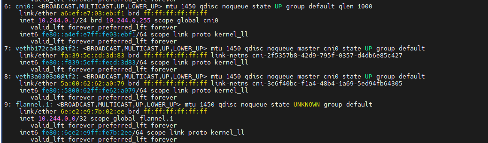
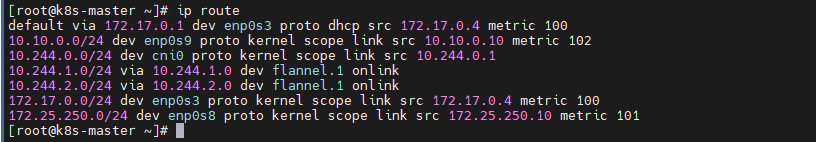
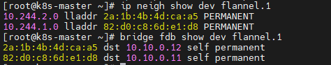

# 2026-09-13 — Day 08 (Phase 3)

## 오늘 목표
- Flannel VXLAN 인터페이스(`flannel.1`) 확인, `ip route`로 실제 라우팅 경로 추적 (Phase 3 진입 첫날)

## 오늘 한 일
- `ip a`로 flannel.1(VXLAN)/cni0(브리지)/veth 구조 확인
- `ip route`로 로컬 Pod 대역(cni0 경유)과 원격 노드 대역(flannel.1 경유) 라우팅 분기 확인
- `ip neigh` + `bridge fdb`로 "가짜 게이트웨이 → ARP → FDB → 실제 노드 IP" 숨은 매핑 원리 확인
- 위 과정에서 Flannel이 NAT망(172.17.x)을 잘못 타고 있는 걸 발견 → `kubectl patch`로 `--iface=enp0s9` 추가해 Internal망으로 수정 완료 (decisions/0003)
- 조사 도중 발생한 커널 soft lockup + 노드 전체 NotReady 장애 대응 (INC-001)

## 왜 이 설정/방법을 선택했는가
| 항목 | 선택한 것 | 대안 | 선택 이유 |
|---|---|---|---|
| Flannel 인터페이스 지정 | `--iface=enp0s9` (kubectl patch) | `kubectl edit`으로 수동 YAML 편집 | edit은 YAML 들여쓰기 오류로 실패, patch는 JSON 배열 append라 들여쓰기 실수 여지 없음 |

## 오늘 처음 안 사실
| 몰랐던 것 | 알게 된 것 | 왜 그렇게 되는지 |
|---|---|---|
| flannel.1 MTU가 1450인 이유 | VXLAN 캡슐화 오버헤드(50바이트)를 미리 뺀 값 | 1500(물리 MTU) − 50(캡슐화 헤더) = 1450 |
| `via X dev flannel.1 onlink` 라우팅 의미 | 실제 게이트웨이가 아니라 ARP+FDB로 진짜 목적지를 찾는 트리거용 가짜 주소 | flanneld가 미리 ARP/FDB 테이블을 조작해둠 |
| kubelet InternalIP ≠ Flannel public-ip 결정 로직 | kubelet은 명시적 설정(advertise-address)을 따르지만 Flannel은 기본 경로 기준 자동 탐지 | Day2에서 Host-only/Internal에 never-default를 걸어 NAT만 기본 경로를 가지게 된 것이 원인 |
| kubelet 에러 5종(런타임다운/PLEG불량/lease실패/scheduler CrashLoop/housekeeping지연)이 사실 한 원인 | CPU 순간 정지(soft lockup) 하나가 여러 하위 기능을 동시에 멈추게 함 | kubelet housekeeping 지연 시각과 커널 soft lockup 시각이 정확히 일치 |
| Node AGE ≠ VM uptime | 서로 다른 시계(K8s 오브젝트 나이 vs 커널 부팅 이후 시간) | Node 오브젝트는 재부팅해도 etcd에 유지되지만 uptime은 커널 기준 리셋 |
| vmstat의 steal(st) | 호스트가 CPU를 안 줘서 못 쓴 시간 비율 | steal=0이면 최소한 그 순간은 호스트 탓이 아니라는 판단 근거가 됨 |

## 검증 결과
```bash
# flannel.1 확인
ip a
# → flannel.1 mtu 1450 확인

# 라우팅 분기 확인
ip route
# 10.244.0.0/24 dev cni0 (로컬)
# 10.244.1.0/24, 10.244.2.0/24 via ... dev flannel.1 onlink (원격)

# 숨은 매핑 확인 (여기서 NAT망 오류 최초 발견)
ip neigh show dev flannel.1
bridge fdb show dev flannel.1
# → dst가 172.17.x로 나옴

# 최종 확인 (수정 전)
kubectl get nodes -o jsonpath='{range .items[*]}{.metadata.name}{"\t"}{.metadata.annotations.flannel\.alpha\.coreos\.com/public-ip}{"\n"}{end}'
# k8s-master 172.17.0.4 / k8s-worker1 172.17.0.3 / k8s-worker2 172.17.0.5

# 수정
kubectl patch daemonset kube-flannel-ds -n kube-flannel --type='json' \
  -p='[{"op":"add","path":"/spec/template/spec/containers/0/args/-","value":"--iface=enp0s9"}]'

# 수정 후 확인
kubectl get nodes -o jsonpath='{range .items[*]}{.metadata.name}{"\t"}{.metadata.annotations.flannel\.alpha\.coreos\.com/public-ip}{"\n"}{end}'
# k8s-master 10.10.0.10 / k8s-worker1 10.10.0.11 / k8s-worker2 10.10.0.12  ✅
```

## 결과·증거

`flannel.1` 인터페이스가 MTU 1450으로 생성된 것을 확인. VXLAN 캡슐화 오버헤드(50바이트)를
미리 반영한 값으로, 실제 캡슐화가 이루어지고 있다는 근거.


같은 노드의 Pod 대역(10.244.0.0/24)은 `cni0` 브리지로, 다른 노드 대역(10.244.1.0/24,
10.244.2.0/24)은 `flannel.1`로 나가도록 라우팅 테이블이 분리되어 있음을 확인.


`via 10.244.x.0 dev flannel.1 onlink` 라우팅의 실제 동작 원리 확인 — 가짜 게이트웨이 IP를
ARP 테이블에서 MAC으로, 그 MAC을 FDB에서 실제 노드 IP로 변환하는 이중 매핑 구조를 확인.
(참고: 조사 당시엔 dst가 NAT망 172.17.x로 나왔으나, `--iface` 수정 후 재캡처하여
Internal망(10.10.x)으로 정상화된 상태가 찍혀 있음)

## 다른 노드 Pod로 가는 길: 가짜 게이트웨이와 표 두 개

### 한 줄 요약
다른 노드의 Pod로 보낼 때, 커널은 **표를 두 번 조회**(ARP 표 → FDB 표)해서 "어느 노드 IP로 보낼지"를 알아낸 뒤 그 노드로 포장해서 보낸다. 이 조회를 시작시키는 주소가 **가짜 게이트웨이**다.

### 택배로 비유하면

| 택배 | 실제 네트워크 |
|---|---|
| 받는 사람 | 목적지 Pod IP (예: `10.244.1.5`) |
| 상대 지점의 접수 창구 번호 | **가짜 게이트웨이** `10.244.1.0` |
| 창구 번호 → 창구 명찰 | **ARP 표**: IP → MAC |
| 창구 명찰 → 지점 실제 주소 | **FDB 표**: MAC → 노드 IP (예: `10.10.0.11`) |
| 박스에 담아 배송 | VXLAN 포장 후 UDP 8472로 전송 |

### 가짜 게이트웨이가 뭔가
`10.244.1.0/24 via 10.244.1.0 dev flannel.1 onlink`에서 `via` 뒤의 `10.244.1.0`을 말한다.

- **진짜 라우터가 아니다.** 패킷을 대신 전달해 주는 장비가 없다.
- 하는 일은 하나: ARP 표와 FDB 표를 따라가서 **상대 노드 IP를 알아내게 하는 중간 주소**.
- 이 주소는 **상대 노드의 `flannel.1` 인터페이스 주소**일 가능성이 높다. 그래서 ARP 표에 "이 주소 = 상대 flannel.1의 MAC"이 미리 들어 있다.
  - 일반 지식이며 일지에서 직접 확인한 건 아님.
  - 확인하려면 워커에서 `ip -d addr show flannel.1`로 `10.244.x.0` 주소가 있는지 본다.

**왜 이렇게 만들었나?**
VXLAN은 이더넷 프레임을 포장하는 방식이라 목적지 MAC이 필요하다. Pod IP(`10.244.1.5`)로 MAC을 찾게 하면 flanneld가 Pod마다 표를 만들어야 하는데, Pod는 계속 죽고 생긴다. **노드마다 고정된 주소 하나**를 거치게 하면 표는 노드당 한 줄이면 된다.

### 4단계 과정

Pod IP `10.244.1.5`, 상대 노드 IP `10.10.0.11`은 설명용 가정이다. 실제 값은 일지에 없음.

| 단계 | 보는 곳 | 알아내는 것 | 확인 명령 |
|---|---|---|---|
| 1 | 라우팅 표 | "`10.244.1.x`는 `10.244.1.0`을 거쳐 flannel.1로 보내라" | `ip route` |
| 2 | **ARP 표** | `10.244.1.0`의 MAC은 `aa:bb:..` | `ip neigh show dev flannel.1` |
| 3 | **FDB 표** | MAC `aa:bb:..`은 노드 IP `10.10.0.11` 뒤에 있음 | `bridge fdb show dev flannel.1` |
| 4 | (포장) | `10.10.0.11`로 UDP 8472 전송 | - |

```
Pod IP(10.244.1.5)
  → ① 라우팅 표:  가짜 게이트웨이 10.244.1.0
  → ② ARP 표:     MAC aa:bb:..
  → ③ FDB 표:     노드 IP 10.10.0.11
  → ④ 포장해서 UDP 8472로 전송
```

### 헷갈리기 쉬운 점: ARP는 안 하는데 왜 ARP 표가 나오나?

| | 하는가 | 설명 |
|---|---|---|
| ARP **요청/응답** ("이 IP의 MAC이 뭐냐"고 네트워크에 묻는 동작) | 안 함 | flanneld가 표를 **미리 채워 둠** |
| ARP **표** 조회 (`ip neigh`) | 함 | 커널이 패킷을 보낼 때 이 표를 읽음 |

표는 읽지만, 표를 채우려고 네트워크에 묻지는 않는다.

### 8일차에서 이게 쓰인 곳
3단계 FDB 표(`bridge fdb`)에서 `dst`가 `172.17.x`(NAT망)로 나왔다. 의도한 건 `10.10.x`(Internal망)였다. 여기서 Flannel이 NAT망을 타고 있다는 걸 발견했다. (decisions/0003)

## 복습 문제와 정답 (2026-11-14)

| # | 질문 | 정답 | 직접 답한 결과 |
|---|---|---|---|
| 1 | `via 10.244.1.0 dev flannel.1 onlink`의 가짜 게이트웨이는? 실제 노드 IP는 어디서 찾나? | 라우팅이 가리킨 주소를 **ARP 표**(`ip neigh`)에서 MAC으로, **FDB 표**(`bridge fdb`)에서 노드 IP로 바꿔 그 노드로 **UDP 8472** 포장 전송. 가짜 게이트웨이는 패킷을 전달하는 라우터가 아니라 이 조회를 일으키는 중간 주소 | 부분 점수(ARP 표 단계 누락). 이후 정답을 보고 기록 |
| 2 | Flannel이 NAT망을 선택한 이유는? | Flannel은 `--iface` 미지정 시 **기본 경로를 가진 인터페이스**를 자동 선택. Host-only/Internal에 `never-default`를 걸어서 NAT만 기본 경로를 가짐 | ⭕ |
| 3 | flannel.1의 MTU가 1450인 이유는? | 물리 MTU 1500 − VXLAN 포장 헤더 50바이트. 포장하면 패킷이 50바이트 커지므로 미리 빼 둬야 물리 MTU(1500)를 넘지 않음 | △ 결론만 맞음(이유 보강) |
| 4 | (7일차) 마스터가 Ready가 된 이유는? | Flannel이 노드에 CNI 설정을 설치 → kubelet이 "네트워크 플러그인 준비됨"으로 보고 → `NetworkPluginNotReady` 해소. Pod 대역이 Flannel 기본값과 같다는 건 YAML을 안 고쳐도 된 이유일 뿐 | △ 방향은 맞음("CNI 연결"의 의미 보강) |
| 5 | (7일차) join에서 토큰과 CA 해시는 각각 누가 누구를 확인하나? | 토큰: 마스터가 워커를 확인. CA 해시: 워커가 마스터를 확인 | ⭕ (11/9에 이어 2회 연속) |

(3번 보충, 일반 지식: 50바이트 = 바깥 IP 20 + UDP 8 + VXLAN 8 + 안쪽 이더넷 14. 일지에서 직접 확인한 값은 "50"까지.)

## 막힌 점
- `kubectl edit ds kube-flannel-ds` 시도 시 YAML 문법 오류로 편집 실패 → `kubectl patch --type=json`으로 우회 성공
- INC-001: 재부팅 직후 CPU soft lockup 반복 발생, "일시적 초기화 폭주"로 잠정 결론(호스트 8코어/VM 총 6vCPU로 상시 오버커밋 아님 확인). 재발 시 uptime + steal 확인해서 재판단 필요

