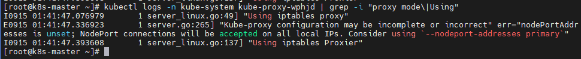
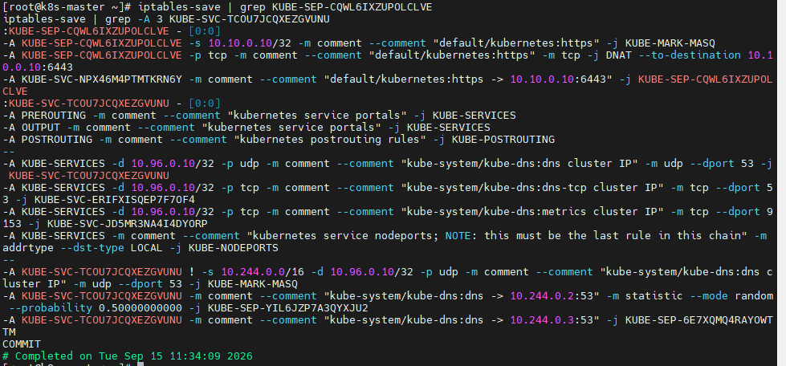

# 2026-09-15 — Day 09 (Phase 3)

> 2026-11-18 복습하면서 쉬운 말로 다시 정리함. 로그, 규칙, 값 같은 사실은 그대로이고 설명과 순서만 바꿈. "일반 지식"이라고 적은 부분은 이 프로젝트에서 직접 확인하지 않은 내용.

## 오늘 목표
- kube-proxy가 어떤 방식(iptables/IPVS)으로 일하는지 확인
- Service의 가짜 주소(ClusterIP)가 진짜 Pod 주소로 바뀌는 과정을 직접 따라가기

## 한 줄 요약
**Service 주소(ClusterIP)는 가짜 주소이고, 각 노드의 iptables 규칙이 그 주소를 진짜 Pod 주소로 바꿔치기(DNAT)해 준다. 그 규칙을 만들어 두는 게 kube-proxy.**

Pod는 죽으면 새 IP로 다시 생겨서 IP가 계속 바뀜. 그래서 안 바뀌는 대표 주소(ClusterIP)를 두고, 그 뒤에서 진짜 Pod로 연결함.

| 회사 대표번호 비유 | 쿠버네티스 |
|---|---|
| 대표번호 | ClusterIP (가짜 주소, 실제 전화기 없음) |
| 담당자 직통번호 | Pod IP (진짜 주소) |
| 전화를 돌려주는 교환 규칙 | iptables 규칙 |
| 교환 규칙을 만들어 두는 사람 | kube-proxy |

## 이야기로 보면

1. 클러스터 안의 Pod가 마스터(apiserver)에게 말을 걸고 싶다.
2. apiserver 주소를 그대로 쓰면 나중에 바뀔 수 있어서 불안하다.
3. 그래서 쿠버네티스가 **대표 주소 `10.96.0.1:443`** 을 만들어 준다. 이 주소를 가진 컴퓨터는 어디에도 없다.
4. Pod가 이 대표 주소로 보내면, 노드의 커널이 **규칙표(iptables)** 를 본다.
5. 규칙표에 "`10.96.0.1:443`으로 가는 패킷이면 목적지를 `10.10.0.10:6443`으로 바꿔서 보내라"고 적혀 있다.
6. 그래서 진짜 apiserver에 도착한다.

이 "목적지를 바꿔서 보내는 것"이 **DNAT**, 규칙표를 만들어 두는 프로그램이 **kube-proxy**.

## 오늘 확인한 5가지

"이게 정말 그렇게 돼 있나" 직접 열어서 확인한 것.

| # | 확인한 것 | 쉬운 뜻 |
|---|---|---|
| 1 | kube-proxy 모드 = iptables | 로그의 `Using iptables Proxier`. kube-proxy가 iptables 규칙표를 쓰는 방식. 다른 선택지로 IPVS가 있음 (일반 지식) |
| 2 | `nodePortAddresses is unset` 경고 | NodePort(바깥에서 들어오는 문)를 특정 주소로 제한하지 않았다는 뜻. 노드가 가진 모든 주소에서 열림. Day 10에서 다시 나옴 |
| 3 | `kubernetes` 서비스 추적 | ClusterIP `10.96.0.1:443`, 백엔드 apiserver 1개. 위 이야기의 5번을 규칙표에서 실제로 찾아서 봄 |
| 4 | `kube-dns` 서비스 분배 규칙 | ClusterIP `10.96.0.10:53`, 백엔드 CoreDNS Pod 2개. 담당자가 2명이면 어떻게 나누는지 확인 |
| 5 | `KUBE-NODEPORTS` 체인이 비어 있음 | Day 10에서 NodePort 서비스를 만든 뒤 달라지는 걸 비교하려는 기준점 |

## 규칙표 안쪽 (`kubernetes` 서비스 기준)

```
10.96.0.1:443  (가짜 주소)
  → KUBE-SERVICES          안내 데스크: 어느 서비스 주소지?
  → KUBE-SVC-NPX46M4P...   담당 부서: 담당자 중 누구로 보낼까?
  → KUBE-SEP-CQWL6IXZ...   담당자 연결: 진짜 주소로 바꾸기
  → DNAT --to-destination 10.10.0.10:6443   (진짜 apiserver)
```

| 단계 | 하는 일 |
|---|---|
| `KUBE-SERVICES` | 어느 서비스 주소인지 구분 (`10.96.0.1`인지 `10.96.0.10`인지) |
| `KUBE-SVC-xxx` | 그 서비스의 백엔드 중 하나를 고름 |
| `KUBE-SEP-xxx` | 고른 백엔드로 실제 DNAT (SEP = Service EndPoint) |

- 3단계로 나눈 이유는 **정리하려고**. 서비스가 수백 개여도 찾기 쉽게 칸을 나눈 것 ("학교 → 2학년 → 수학.pdf").
- **칸 이름과 `NPX46M4P...` 같은 해시는 외우지 않아도 됨.** 해시는 서비스/백엔드마다 자동으로 붙는 구분용 번호표.
- 이 서비스는 담당자가 apiserver 1명이라 고르는 과정(확률)이 없음.

**담당자가 둘이면 동전 던지기.** `kube-dns`는 CoreDNS가 2개라서:
- "50% 확률로 걸리면 Pod 1로"
- "안 걸리면(나머지 전부) Pod 2로"

진짜 로드밸런서가 있는 게 아니라 확률 규칙을 순서대로 쌓아서 흉내 낸 것. 백엔드가 많아지면 규칙도 늘어나 느려질 수 있음 (일반 지식, 측정하지 않음).

## CoreDNS가 뭔가

**클러스터 안의 전화번호부 서버.** 이름을 알려주면 IP를 알려줌.

- DNS = 이름 → IP로 바꿔주는 서버. Day 6의 `/etc/hosts`가 "내 컴퓨터 안의 전화번호부"라면 DNS는 "전화번호부 서버".
- Service에는 이름이 있음(예: `nginx-test-svc`). 그 이름을 ClusterIP로 바꿔주는 게 CoreDNS의 일.
- 특별한 장비가 아니라 **그냥 Pod** (오늘 2개 확인). 이 Pod들 앞에도 Service가 있고 이름이 `kube-dns`.

Pod가 `nginx-test-svc` 이름으로 접속할 때의 순서:

```
① Pod: "nginx-test-svc가 어디야?" → CoreDNS(10.96.0.10)에게 물어봄
        (이 주소도 가짜라서 kube-proxy 규칙이 CoreDNS Pod 중 하나로 연결해 줌)
② CoreDNS: "ClusterIP는 10.96.x.x야"          ← 이름 → IP  (CoreDNS의 일)
③ Pod: 10.96.x.x로 보냄 → kube-proxy 규칙이 진짜 Pod IP로 바꿔줌   ← 주소 → 주소  (kube-proxy의 일)
```

| | CoreDNS | kube-proxy |
|---|---|---|
| 하는 일 | 이름 → IP 알려주기 | 가짜 주소 → 진짜 주소 바꾸기 |
| 비유 | 전화번호부에서 번호 찾아주기 | 대표번호를 직통번호로 돌려주기 |
| 이름을 아는가 | 안다 | 모른다. IP만 봄 |

- `10.96.x.x`는 설명용 자리표시이고 실제 값은 일지에 없음.
- Pod가 CoreDNS를 찾아가는 방법(Pod 안의 `/etc/resolv.conf`)과 `kube-dns`가 옛 이름을 유지한 것이라는 점은 일반 지식. Day 11~12에서 직접 확인할 부분.

## 1~8일차와 어떻게 이어지나

새로운 개념은 2개뿐이고 나머지는 이미 배운 것에 이름이 붙은 것.

| 9일차에 나온 것 | 이미 아는 것 | 연결 |
|---|---|---|
| iptables | Day 3 | "로비 검색대"로 배움. Day 3 일지에 "Service(kube-proxy)는 iptables 규칙으로 구현된다"고 이미 있음 |
| `10.10.0.10:6443` | Day 6 | `--apiserver-advertise-address=10.10.0.10`과 API 서버 포트 6443 |
| 가짜 주소로 실체를 숨김 | Day 8 | 가짜 게이트웨이(`10.244.1.0`)와 같은 생각 |
| kube-proxy, CoreDNS Pod | Day 7 | 노드마다 하나씩 뜨는 Pod(DaemonSet)와 일반 Pod. kube-proxy가 DaemonSet이라는 건 일반 지식 |
| 백엔드가 여러 개일 때 나누기 | Deployment 개념 | Pod가 여러 개면 나눠서 보내야 함. 그걸 확률로 함 |

**진짜 새로운 것 2개**
1. **ClusterIP**: Pod IP가 계속 바뀌어서 만든 고정 대표 주소. 실체 없음.
2. **DNAT**: 패킷의 목적지 주소를 중간에서 바꾸는 동작. Day 8의 "가짜 주소 → 진짜 주소"와 같은 종류.

**8일차 Flannel과는 역할이 나뉨**

```
Pod가 Service 주소(가짜)로 보냄
  ↓ [9일차] kube-proxy 규칙이 "진짜 Pod IP"를 정함      ← 누구한테 보낼지
  ↓ [8일차] Flannel이 그 Pod까지 길을 만들어 전달        ← 어떻게 갈지
상대 노드의 Pod
```

- 개념상의 순서이고, 한 패킷을 끝까지 추적한 기록은 일지에 없음.
- `kubernetes` 서비스의 도착지는 노드 IP(`10.10.0.10`)라서 Flannel 터널이 필요 없음. 도착지가 Pod 대역(`10.244.x.x`)이고 다른 노드에 있을 때 Flannel이 일함 (추론. CoreDNS Pod의 실제 IP는 일지에 없음).

## 오늘 궁금해서 물어본 질문

| 질문 | 쉬운 답 |
|---|---|
| NodePort가 관리망/클러스터망 구분 없이 열리는 이유는? | 규칙의 조건이 특정 인터페이스가 아니라 `--dst-type LOCAL`(노드가 가진 모든 주소)이라서 |
| kube-proxy의 주소 바꾸기가 Flannel의 ARP/FDB 구조랑 비슷한가? | 가짜 주소로 실체를 숨긴다는 생각은 같음. 다만 Flannel은 MAC이 필요해서 3단계, kube-proxy는 목적지 주소만 바꾸면 돼서 1단계로 훨씬 단순함 |
| ClusterIP → Pod IP 변환이 정확히 무슨 뜻인가? | ClusterIP는 실체 없는 가짜 주소. 그 주소로 오는 패킷의 목적지를 커널이 iptables 규칙으로 몰래 바꿔치기(DNAT)해서 진짜 Pod에 도달시키는 것 |

## 오늘 처음 안 사실 (이것만 기억)

| 몰랐던 것 | 알게 된 것 | 왜 그런가 |
|---|---|---|
| ClusterIP가 뭔지 | 가짜 주소. 어느 인터페이스에도 붙어 있지 않음 | Pod IP가 계속 바뀌어서 고정 대표 주소가 필요함 |
| 가짜 주소가 진짜 주소로 바뀌는 방법 | iptables 규칙이 DNAT으로 바꿈. 마지막 한 칸(`KUBE-SEP`)에서만 바뀜 | kube-proxy가 규칙을 만들어 두고, 서비스별/백엔드별로 칸을 나눠 관리함 |
| 백엔드가 여러 개일 때 나누는 방식 | 확률 규칙(`-m statistic --mode random --probability`)을 순서대로 쌓음 | iptables에는 로드밸런서 기능이 없어서 확률로 흉내 냄 |
| kube-proxy와 CoreDNS의 차이 | kube-proxy는 DNS가 아님. 이름 → IP는 CoreDNS, 주소 → 주소 바꾸기는 kube-proxy | 이름을 아는 건 CoreDNS뿐이고 kube-proxy는 IP만 봄 |

## 앞으로 이어질 곳

| Day | 연결 |
|---|---|
| 10 | NodePort 서비스를 만들면 오늘 비어 있던 `KUBE-NODEPORTS` 칸이 채워짐. Day 6 방화벽, 8472/udp 장애(INC-002)와 만남 |
| 11~12 | CoreDNS가 "이름 → ClusterIP"를 바꾸고, 그 ClusterIP를 오늘 본 규칙이 다시 Pod IP로 바꿈 |

## 검증 결과
```bash
$ kubectl logs -n kube-system kube-proxy-wphjd | grep -i "proxy mode\|Using"
I0915 ... "Using iptables proxy"
I0915 ... "Using iptables Proxier"

$ iptables-save | grep KUBE-SEP-CQWL6IXZUPOLCLVE
-A KUBE-SEP-CQWL6IXZUPOLCLVE -p tcp -j DNAT --to-destination 10.10.0.10:6443

$ iptables-save | grep -A 3 KUBE-SVC-TCOU7JCQXEZGVUNU
... --probability 0.5 -j KUBE-SEP-YIL6JZP7A3QYXJU2
... -j KUBE-SEP-6E7XQMQ4RAYOWTTM

$ kubectl get nodes
k8s-master   NotReady → (복구 후 Ready)
$ uptime
load average: 9.04, 3.36, 3.14 (부팅 36분 후)
```

## 결과·증거

*kube-proxy 로그에서 "Using iptables Proxier" 확인 — iptables 모드로 동작 중임을 보여줌*


*ClusterIP를 실제 Pod IP로 바꾸는 DNAT 규칙과, 백엔드 2개일 때 확률 기반으로 분배되는 로드밸런싱 규칙을 함께 확인*

## 막힌 점
- 없음
- 확인 필요: 위 검증 결과에 `NotReady → (복구 후 Ready)`와 `load average 9.04 (부팅 36분 후)`가 기록돼 있음. 재부팅 직후 불안정(INC-001과 같은 증상)이었는지 확인하고, 맞다면 INC-001에 반영할 것.
