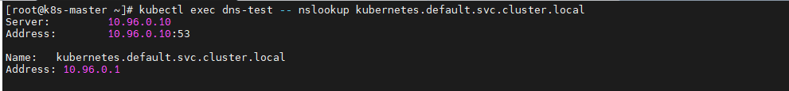
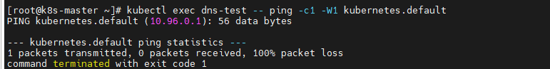

# 2026-09-21 — Day 12 (Phase 3)

## 오늘 목표
- Day 11(CoreDNS) 복습: "Pod 안에서 `kubernetes.default`가 ClusterIP까지 풀리는 과정"을 근거와 함께 설명할 수 있는가
- Phase 3 정리 + 회고 (회고는 `phase3-retrospective.md`에 별도 작성)

## 오늘 한 일
- **재부팅 후 firewalld 설정 유지 여부 검증**: 3대 모두 `trusted`에 `cni0 flannel.1` 적용 + `--permanent` 저장 확인 (Day 10 설정이 재부팅을 견딤)
- `dns-test`(busybox) Pod를 `sleep 3600`으로 띄워 CoreDNS 경로 검증 (아래 검증 결과 참고)
- master 쪽 trusted zone 적용 여부(Day 10에서 미확인이던 항목) 확인 완료

## 복습 (Day 11 — CoreDNS)
시작 루틴의 복습 질문 2개. 처음엔 문제 문장 자체를 이해하지 못했고("이 문제가 무슨 소리인지도 모르겠음"), 쉬운 말로 재해석 → 직접 실습 → 다시 답하는 순서로 채웠다.
 
### 복습 Q1. Pod 안에서 `kubernetes.default`가 ClusterIP까지 해석되는 과정
쉬운 말로 바꾸면: "Pod 안에서 **이름**을 치면 컴퓨터가 어떻게 **숫자 IP**로 바꾸는지 순서대로 말해 봐."
 
이해를 위한 비유(휴대폰 연락처):
 
| 휴대폰 | K8s |
|---|---|
| 연락처 앱 (이름 → 번호) | **CoreDNS** (이름 → IP) |
| 연락처 앱이 어디 있는지 적힌 설정 | `/etc/resolv.conf`의 **nameserver** |
| "김철수"만 쳐도 "우리반 김철수" 등을 자동으로 붙여 검색 | **search** 도메인 (`ndots:5`보다 점이 적으면 붙여 봄) |

내가 쓴 1차 답:
1. pod는 /etc/resolv.conf 의 nameserver를 보고 core-dns에 질문을 보낸다.
2. 이름에 점이 5개 미만이라 search 도메인을 뒤에 붙여서 ? 로 만든다
3. 질문은 kube-proxy의 dns 때문에 실제 coreDns Pod로 전달된다
채점과 정정:
 
| 번호 | 평가 | 정정 |
|---|---|---|
| 1 | 맞음 | 정확히는 CoreDNS Pod가 아니라 **kube-dns Service의 ClusterIP(`10.96.0.10`)**에 질문함 |
| 2 | 방향 맞음 | `?` = `kubernetes.default.svc.cluster.local`. search 순서상 `kubernetes.default.default.svc.cluster.local`이 먼저 실패하고 다음 시도에서 성공 |
| 3 | **틀림** | kube-proxy는 DNS가 아니라 **iptables DNAT 룰**로 `10.96.0.10`을 CoreDNS Pod IP로 바꿔 줌 |
| 4 | 비어 있었음 | CoreDNS가 `10.96.0.1`을 답함 |
 
완성본:
> 1. Pod는 `/etc/resolv.conf`의 **nameserver**를 보고 `10.96.0.10`(kube-dns Service)에 질문을 보낸다.
> 2. 이름에 점이 5개 미만이라 **search** 도메인을 붙여 `kubernetes.default.svc.cluster.local`로 만든다.
> 3. 질문은 kube-proxy의 **iptables DNAT 룰** 때문에 실제 CoreDNS Pod IP로 바뀌어 전달된다.
> 4. CoreDNS가 `10.96.0.1`을 답해 준다.

## 왜 이 설정/방법을 선택했는가
| 항목 | 선택한 것 | 대안 | 선택 이유 |
|---|---|---|---|
| 검증 방식 | `exec`로 `resolv.conf` / `nslookup` / `ping` 3종 | `nslookup` 하나만 | 도구마다 이름 푸는 방식이 달라서, 하나의 결과만 보면 오판함  |
| 이미지 | `busybox` (테스트 전용) | `busybox:1.28`, dnsutils | 가볍고 nslookup/ping/wget 내장. 단 버전 고정 안 한 점은 한계 |

## 오늘 처음 안 사실
| 몰랐던 것 | 알게 된 것 | 왜 그렇게 되는지 |
|---|---|---|
| `NXDOMAIN`의 의미 | 장애가 아니라 **DNS 서버가 "그 이름 없다"고 응답한 것** | 타임아웃이 아니라 응답이 온 것이므로 경로(kube-proxy DNAT + Flannel 터널 + CoreDNS)는 살아 있다는 증거 |
| 도구별 이름 풀이 차이 | busybox `nslookup`은 짧은 이름을 그대로만 질의해 `NXDOMAIN`, `ping`은 search 도메인을 붙여 풀림 | `nslookup`(busybox 구현)은 search 목록을 적용하지 않고, `ping`은 시스템 리졸버(libc)를 써서 `resolv.conf`의 search를 적용 |
| ClusterIP는 ping이 안 됨 | `PING kubernetes.default (10.96.0.1)`은 풀렸지만 100% packet loss | ClusterIP는 kube-proxy가 TCP/UDP 포트 단위로 DNAT하는 가짜 주소라 ICMP에는 응답할 주체가 없음 |
| Pod의 `resolv.conf` search | `tail731ab4.ts.net dja.kr`이 붙어 있음 (K8s가 넣은 게 아님) | Pod는 기본적으로 노드의 `resolv.conf` 설정을 상속함 |
| kube-proxy와 CoreDNS의 역할 | kube-proxy는 이름 해석(DNS)이 아니라 **가짜 IP → Pod IP 변환(DNAT)** | DNS 질의도 `10.96.0.10`(kube-dns Service)로 가는 평범한 트래픽이라 kube-proxy 룰을 거쳐 CoreDNS Pod로 전달됨 |

## 검증 결과
```bash
# 1) 노드 상태 (VM 기동 전)
kubectl get nodes
#  k8s-master  Ready / k8s-worker1  NotReady / k8s-worker2  NotReady

# 2) VM 기동 후
kubectl get nodes -w          # 3노드 모두 Ready
kubectl get pods -A -o wide   # 전체 Running 1/1
#  kube-flannel / kube-proxy RESTARTS 3~6회 (재부팅 흔적)
#  coredns 2개 모두 k8s-master에서 실행 중
#  nginx-test Pod 2개는 AGE 12m (재생성된 것으로 보임)

# 3) 재부팅 후 firewalld 유지 확인 (master, worker1, worker2 동일)
firewall-cmd --get-active-zones
#  public: enp0s3 enp0s8 enp0s9 / trusted: cni0 flannel.1
firewall-cmd --permanent --zone=trusted --list-interfaces
#  cni0 flannel.1   (runtime과 permanent가 일치)

# 4) DNS 경로 검증
kubectl get svc -n kube-system kube-dns
#  ClusterIP 10.96.0.10
kubectl exec dns-test -- cat /etc/resolv.conf
#  nameserver 10.96.0.10 / ndots:5 / search default.svc.cluster.local svc.cluster.local cluster.local ...
kubectl exec dns-test -- nslookup kubernetes.default
#  Server 10.96.0.10 응답, NXDOMAIN  (서버는 응답함, 이름 그대로 질의해서 없음)
kubectl exec dns-test -- nslookup kubernetes.default.svc.cluster.local
#  Address: 10.96.0.1  (성공)
kubectl exec dns-test -- ping -c1 -W1 kubernetes.default
#  PING kubernetes.default (10.96.0.1)  -> search 적용 확인, 100% loss는 정상(ClusterIP는 ICMP 무응답)
```

## 결과·증거

> 풀네임 `kubernetes.default.svc.cluster.local`을 조회하면 CoreDNS(`10.96.0.10`)가 ClusterIP `10.96.0.1`로 응답한다 — CoreDNS 정상 baseline.

> 짧은 이름 `kubernetes.default`만 줘도 `ping`이 `(10.96.0.1)`로 풀어 낸다 — `resolv.conf`의 search 도메인이 자동으로 붙는다는 증거 (100% packet loss는 ClusterIP가 ICMP에 응답하지 않아서 정상).

## 막힌 점
- `kubectl run -it --rm dns-test ...`가 출력 없이 멈춤 → 원인은 (1) 워커 VM이 꺼져 있어 스케줄할 노드가 없었고, (2) VM 기동 후에도 `busybox` 첫 이미지 pull에 약 1분이 걸려 `kubectl`의 대기 시간(timed out)을 넘김. 장애가 아니라 환경/타이밍 문제였음
- 복습 질문에서 "kube-proxy가 DNS를 한다"고 잘못 답함 → kube-proxy는 이름 해석이 아니라 가짜 IP를 Pod IP로 바꿔 주는 DNAT 역할이라는 점을 실습으로 정정

## 다음에 볼 것 (오늘 미확인)
- CoreDNS scale 0 실험은 일정표대로 Day 15(INC)에서 진행. 예측: 이름 호출은 실패, ClusterIP 직접 호출은 성공

